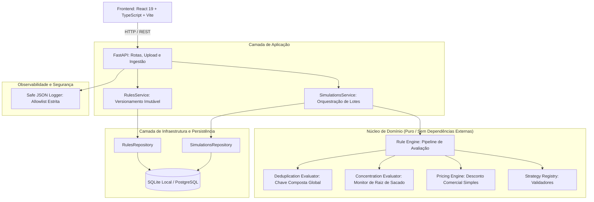

# Arquitetura do Sistema — Antecipe FIDC

Este documento detalha o desenho arquitetural da plataforma **Antecipe FIDC**, cobrindo camadas de software, contratos de domínio, fluxo de dados de alta vazão e diretrizes de integridade financeira.

---

## 1. Visão Geral e Princípios Arquiteturais

A solução foi projetada como um **Monólito Modular** fundamentado nos princípios da Engenharia de Software limpa e na filosofia Unix:
- **Separação Estrita de Responsabilidades:** Domínio puro isolado de frameworks web e bancos de dados.
- **Transparência e Explicabilidade:** Cada título recusado possui código de erro canônico, causa detalhada e próximo passo acionável.
- **Zero Suposições Ocultas:** Regras financeiras parametrizadas via JSON declarativo e versionado (`validadores_antecipe.json`).
- **Precisão Financeira Estrita:** Desconto comercial simples e totalizadores operados exclusivamente com `decimal.Decimal` e arredondamento comercial `ROUND_HALF_UP`.
- **Streaming Unix de Baixa Pegada de Memória:** Processamento de arquivos linha a linha sem retenção de payloads completos na RAM.

---

## 2. Diagrama de Camadas (Monólito Modular)

---

## 3. Fluxo de Dados e Processamento de Lotes

1. **Recepção do CSV:** Ingestão via endpoint multipart `POST /api/simulations` ou avaliação via JSON `POST /api/receivables/evaluate`.
2. **Parser Streaming:** Leitura iterativa linha a linha via gerador Python, validando encoding UTF-8 e estrutura de cabeçalho delimitada por ponto e vírgula.
3. **Validação Estrutural e de Tipos:** Conversão de valores nominais em centavos estritos (ADR-008) e datas no padrão `dd/mm/aaaa`.
4. **Avaliação pelo Motor de Regras (Strategy + Registry):**
   - Execução ordenada das regras ativas.
   - Avaliação determinística do primeiro motivo de recusa para eficiência de fluxo.
   - Checagem antiduplicidade contra todo o estoque histórico global (`DUPLICIDADE_HISTORICA`) e intra-lote (`DUPLICIDADE_LOTE`).
   - Monitoramento dinâmico da concentração por raiz de CNPJ ($\le 10{,}0\%$ aceita; $> 10{,}0\%$ recusada).
5. **Precificação dos Elegíveis:** Cálculo de desconto simples com base 30 dias e `ROUND_HALF_UP` comercial no centavo.
6. **Persistência Transacional:** Registro dos resultados e criação de envelope de simulação com paginação eficiente.

---

## 4. Decisões Financeiras e Precisão Contábil

- **Desconto Comercial Simples:**
  $$\text{Valor Líquido} = \text{Valor Nominal} \times \left(1 - \frac{\text{Taxa Mensal} \times \text{Dias}}{30}\right)$$
- **Zero tolerância ao tipo `float`:** Todas as operações utilizam `decimal.Decimal` com precisão exata.
- **Arredondamento:** `ROUND_HALF_UP` aplicado no centavo de cada nota aprovada (arredondamento comercial simples, não bancário).
- **Totalizador:** O total líquido do lote é obtido pela soma aritmética exata dos valores líquidos aprovados, garantindo consistência no centavo.

---

## 5. Antiduplicidade e Idempotência

- **Identidade Composta Global:**
  $$\text{Chave} = \text{DOC\_CEDENTE} + \text{DOC\_SACADO} + \text{TIPO\_RECEBIVEL} + \text{NU\_DOCUMENTO} + \text{DATA\_VENCIMENTO\_ORIGINAL}$$
- **Separação de Parcelas:** Documentos de mesma numeração com vencimentos distintos são reconhecidos como parcelas legítimas.
- **Detecção em Dois Níveis:**
  1. *Estoque Histórico Global:* Identidades já presentes no estoque histórico de qualquer fundo da base são rejeitadas como `DUPLICIDADE_HISTORICA`.
  2. *Intra-Lote:* Repetições idênticas dentro da mesma remessa são identificadas; a primeira é processada e as seguintes são rejeitadas como `DUPLICIDADE_LOTE` (mesmo se a primeira tiver sido recusada por outro critério).

---

## 6. Governança e Observabilidade Segura

- **Logs Estruturados Safe JSON:** Emissão exclusiva de eventos com allowlist estrita (`timestamp`, `level`, `event`, `simulation_id`, `itens_processados`).
- **Prevenção de Vazamento (PII e CSV):** Proibida a inclusão de nomes de sacados/cedentes, números de CNPJ, valores monetários individuais, payloads brutos ou tokens de autenticação nos logs ou nas respostas de erro HTTP.
- **Auditoria de Configuração:** Cada versão de regras possui hash SHA-256 e justificativa imutável.
