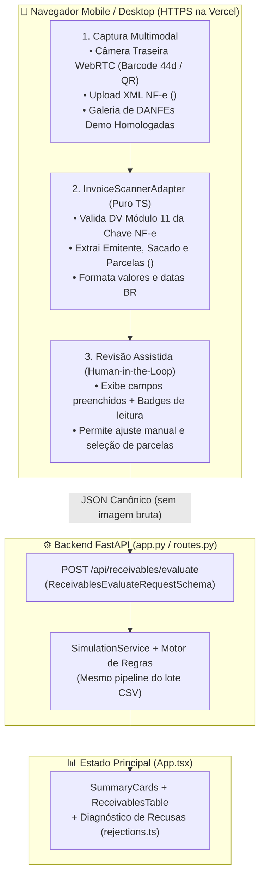

# Arquitetura da Função: Scanner Web Mobile de Nota Fiscal (DANFE / NF-e)

Documento de especificação arquitetural para futura implementação do **Scanner Web de Nota Fiscal via Câmera (`WebRTC`) e XML/QR**, projetado especificamente sobre a estrutura atual do projeto em `Codex/antecipe/` e o deploy na **Vercel**.

---

## 1. Diagnóstico da Base Atual (O que o Carlos já implementou)

A análise dos commits recentes (`c30d8be` e `5502066`) mostra que a infraestrutura principal já possui **100% dos contratos de backend necessários** para o Scanner funcionar sem precisar alterar o motor de domínio:

1. **Endpoint de Avaliação Direta JSON já pronto (`POST /api/receivables/evaluate`):**
   - Localizado em `Codex/antecipe/backend/api/routes.py` (linhas 207–274).
   - Recebe o schema `ReceivablesEvaluateRequestSchema` (`Codex/antecipe/backend/api/schemas.py`, linhas 61–78), que aceita **1 ou múltiplas parcelas** (`recebiveis: List[ReceivelRawInputSchema]`) e `data_base: Optional[str] = "2026-10-22"`.
   - Converte internamente para o mesmo stream do motor (`SimulationService.executar_simulacao_lote`) e devolve o mesmo `SimulationResponseSchema` (`SimulationEnvelope`) usado pelo upload de CSV!
2. **Renderização de Resultados e Recusas já pronta no Frontend:**
   - Em `Codex/antecipe/frontend/src/App.tsx`, o estado `simulation` (`SimulationEnvelope`) alimenta `<SummaryCards />` e `<ReceivablesTable />`, que por sua vez traduzem os códigos de `motivos` usando `Codex/antecipe/frontend/src/services/rejections.ts`.
   - Portanto, quando o Scanner submeter os dados extraídos da nota fiscal para `POST /api/receivables/evaluate`, basta passar a resposta para `setSimulation(res)` em `App.tsx` e toda a interface de cartões financeiros, tabela de parcelas, motivos detalhados e metadados de auditoria funcionará imediatamente.
3. **Isolamento do Modo Demo na Vercel (`PUBLIC_DEMO_MODE=true`):**
   - O entrypoint da Vercel na raiz (`app.py` $\rightarrow$ `Codex/antecipe/backend/vercel_app.py`) sobe um banco SQLite efêmero (`/tmp/antecipe-vercel-demo.db`) com **5 títulos sintéticos** (totalizando `R$ 501.000,00` de carteira no `ANTECIPE FIDC`) e usa o mapa `DEMO_CADASTRO_SINTETICO` (`Codex/antecipe/backend/application/cadastral_service.py`).
   - Os arquivos estáticos servidos pela Vercel ficam na pasta `public/` da raiz (gerados pelo build do Vite em `Codex/antecipe/frontend`).

---

## 2. Arquitetura do Scanner Web (Filosofia Unix & Desacoplamento)

Seguindo o critério **5.2.3 — Organização do Código e Filosofia Unix (20 pts)** e **5.2.4 — Logs e Credenciais (15 pts)**:

- **Responsabilidade Única:** O Scanner é estritamente um **Adaptador de Entrada Client-Side** (`InvoiceScannerAdapter`). Ele transforma a leitura óptica da câmera (`WebRTC`), chave de acesso de 44 dígitos, QR Code ou XML de NF-e em uma lista de objetos `ReceivelRawInputSchema[]`.
- **Zero Regra de Negócio no Frontend:** O Scanner **não** aprova, **não** recusa e **não** calcula desconto comercial no cliente. Toda validação ocorre no motor Python (`POST /api/receivables/evaluate`).
- **Privacidade por Design (Zero-PII Log):** O processamento de imagem/câmera/XML ocorre 100% na memória do navegador do celular. Nenhuma foto, PDF ou XML bruto é enviado ao backend ou registrado nos logs estruturados (`Codex/antecipe/backend/logger.py`).



---

## 3. Dicionário de Variáveis: Da Nota Fiscal para o `ReceivelRawInputSchema`

Cada nota fiscal escaneada gera **1 ou mais parcelas** (quando o quadro *Fatura / Duplicatas* da DANFE ou a tag `<cobr><dup>` do XML possui parcelamento). Cada parcela preenche um item de `ReceivelRawInputSchema`:

| Variável no Schema (`schemas.py`) | Origem na Nota Fiscal (DANFE / NF-e) | Como o Scanner preenche | Papel no Motor e no Gabarito (`resultado_esperado_100k.json`) |
| :--- | :--- | :--- | :--- |
| `NOME_FUNDO` | Não consta na NF-e (contexto da operação) | Padrão `"ANTECIPE FIDC"` (ou selecionável no modal) | Identifica a carteira do fundo para cálculo de concentração. |
| `DOC_FUNDO` | Não consta na NF-e (contexto da operação) | Padrão `"92.234.400/0001-80"` | Valida compatibilidade com o fundo ativo. |
| `NOME_CEDENTE` | Quadro **Emitente** / Tag `<emit><xNome>` | Extraído do cabeçalho da DANFE / XML / QR | Identificação visual do vendedor/cedente. |
| `DOC_CEDENTE` | **Posições 7–20 da Chave de 44 dígitos** / `<emit><CNPJ>` | Extraído automaticamente do código de barras 1D, QR ou XML | Compõe a chave de antiduplicidade e concentração por cedente. |
| `NOME_SACADO` | Quadro **Destinatário/Remetente** / `<dest><xNome>` | Extraído do bloco Destinatário / XML / QR | Exibido na tabela de resultados e mensagens de recusa. |
| `DOC_SACADO` | Quadro **Destinatário** / Tag `<dest><CNPJ>` | Extraído via QR/XML/OCR e validado matematicamente | Avaliado em `CNPJ_SACADO_VALIDO`, `SITUACAO_CADASTRAL_SACADO` e `CONCENTRACAO_MAXIMA_SACADO` (pelos 8 primeiros dígitos = `RAIZ_CNPJ`). |
| `NU_DOCUMENTO` | **Posições 26–34 da Chave de 44 dígitos** / `<ide><nNF>` | Extraído do código de barras 1D, QR ou XML | Identificador do título (`id` no gabarito) e parte da chave da parcela. |
| `TIPO_RECEBIVEL` | **Posições 21–22 da Chave (`mod`)** | Modelo `55` $\rightarrow$ `"Duplicata"`; NFS-e $\rightarrow$ `"Duplicata de Serviço"` | Avaliado pela regra `TIPO_RECEBIVEL`. |
| `VALOR_NOMINAL` | Quadro **Fatura/Duplicatas** / `<dup><vDup>` | Valor nominal de cada parcela em string (`"5000,00"`) | Avaliado em `VALOR_MINIMO` ($\ge \text{R\$ } 100,00$), soma de concentração e cálculo do `valor_liquido` (desconto simples 2% a.m.). |
| `DATA_VENCIMENTO_ORIGINAL` | Quadro **Fatura/Duplicatas** / `<dup><dVenc>` | Data de vencimento de cada parcela (`"dd/mm/aaaa"`) | Diferencia parcelas da mesma nota na chave única e define o prazo em dias. |
| `DATA_AQUISICAO` | Contexto da simulação (`data_base`) | Preenchido com `"22/10/2026"` (editável para auditoria histórica) | No gabarito de 100k linhas, $\text{prazo} = \text{DATA\_VENCIMENTO\_ORIGINAL} - \text{DATA\_AQUISICAO}$. |

---

## 4. Alinhamento com os Dados Sintéticos da Demo na Vercel (`vercel_app.py` e `cadastral_service.py`)

Um detalhe técnico essencial descoberto no código do Carlos:
Na Vercel (`PUBLIC_DEMO_MODE=true` e `ENABLE_DEMO_CADASTRO=true`), o serviço `cadastral_service.py` utiliza uma política conservadora (`NAO_VERIFICADA` por padrão) e reconhece uma lista específica de CNPJs sintéticos, além dos 5 títulos já inseridos no banco efêmero (`R$ 501.000,00` de carteira total).

Por isso, as **DANFEs / QR Codes de Demonstração do Scanner** devem usar exatamente os CNPJs homologados em `cadastral_service.py` e `vercel_app.py`:

| Cenário de Demonstração no Scanner | `DOC_SACADO` / `NOME_SACADO` | `NU_DOCUMENTO` e Parcelas | Resultado Esperado no Motor (Vercel e Local) |
| :--- | :--- | :--- | :--- |
| **1. Nota Fiscal Parcelada (2x Aprovadas + 1x Prazo Excedido)** | `04.252.011/0001-10`<br>`COMERCIAL ALPHA LTDA` (`ATIVA`) | `NF-SCAN-101` (3 parcelas de `R$ 2.000,00`: venc. `20/11/2026`, `20/12/2026` e `25/05/2027`) | **Sucesso Parcial:** Parcelas 1 e 2 **APROVADAS** com cálculo de valor líquido; Parcela 3 **RECUSADA** por `PRAZO_MAXIMO` ($215\text{ dias} > 180$). |
| **2. Estouro de Concentração por Raiz de CNPJ (> 10%)** | `11.222.333/0002-62` (Filial 0002)<br>`INDUSTRIA GAMA FILIAL SUL` (`ATIVA` na matriz, raiz `11222333`) | `NF-SCAN-202`<br>Valor: `R$ 5.000,00`<br>Venc.: `15/12/2026` | **RECUSADA por `CONCENTRACAO_MAXIMA_SACADO`:** A raiz `11222333` já possui `R$ 50.000,00` (`9,98%` de `R$ 501k`) no banco da Vercel; com `+R$ 5.000,00` vai a `10,87%` ($> 10\%$). |
| **3. Duplicidade de Título já Adquirido no Estoque** | `04.252.011/0001-10`<br>`COMERCIAL ALPHA LTDA` (`ATIVA`) | `NF-HIST-01`<br>Valor: `R$ 1.000,00`<br>Venc.: `20/01/2027` | **RECUSADA por `DUPLICIDADE_RECEBIVEL`:** Já consta no estoque inicial do `ANTECIPE FIDC` (`vercel_app.py`, linha 86). |
| **4. Sacado com Situação Cadastral Inativa + Valor Abaixo do Mínimo** | `33.000.167/0001-01`<br>`EMPRESA INATIVA SA` (`INATIVA`) | `NF-SCAN-404`<br>Valor: `R$ 80,00`<br>Venc.: `20/12/2026` | **RECUSADA com Múltiplos Motivos:** `["SITUACAO_CADASTRAL_SACADO", "VALOR_MINIMO"]` simultaneamente. |

*(Nota: Caso o CNPJ `11222333000262` filial seja usado para demonstrar agrupamento por raiz no modo demo, basta incluí-lo no dicionário `DEMO_CADASTRO_SINTETICO` de `cadastral_service.py` como `ATIVA` ou usar o próprio `11222333000181`).*

---

## 5. Estrutura de Arquivos a Criar (Quando Formos Implementar)

Nenhuma estrutura existente será quebrada. A implementação futura tocará apenas nos seguintes arquivos dentro de `Codex/antecipe/frontend/src/`:

```text
Codex/antecipe/frontend/src/
├── services/
│   ├── invoiceScanner.ts          # [NOVO] Parser de Chave NF-e (44 dígitos + Módulo 11),
│   │                              #        Parser de XML NF-e (<infNFe>/<dup>), QR JSON
│   │                              #        e Presets das 4 DANFEs de demonstração
│   └── api.ts                     # [EDITAR] Adicionar api.evaluateReceivables(payload)
│                                  #          chamando POST /api/receivables/evaluate
├── components/
│   ├── InvoiceScannerModal.tsx    # [NOVO] Modal responsivo Mobile-First com:
│   │                              #        - Aba 1: Câmera Ao Vivo (WebRTC facingMode: environment)
│   │                              #        - Aba 2: Ler XML de NF-e / Chave de 44 dígitos
│   │                              #        - Aba 3: DANFEs de Demonstração (1-Click / QR)
│   │                              #        - Etapa de Revisão Assistida (Human-in-the-loop)
│   └── FileUpload.tsx             # [EDITAR] Adicionar botão secundário ao lado do upload:
│                                  #          "📷 Escanear Nota Fiscal (Câmera / XML)"
└── types/
    └── index.ts                   # [EDITAR] Adicionar interfaces ReceivelRawInput e
                                   #          ReceivablesEvaluateRequest
```

### Detalhe Importante para o Deploy na Vercel:
Como o projeto na raiz serve o bundle estático a partir da pasta `/public` (`public/index.html` e `public/assets/*`), sempre que alterarmos o frontend em `Codex/antecipe/frontend/`, o passo de publicação para a Vercel será:
1. Rodar `npm run build` dentro de `Codex/antecipe/frontend`.
2. Copiar o conteúdo gerado em `Codex/antecipe/frontend/dist/*` para a pasta `public/` da raiz do repositório.

---

## 6. Funcionamento da Câmera Mobile na Vercel (`WebRTC`)

1. **Requisito de Contexto Seguro (`HTTPS`):**
   - A Vercel fornece `HTTPS` por padrão em todas as URLs de produção e preview (`https://*.vercel.app`), habilitando `navigator.mediaDevices.getUserMedia` no Safari (iOS) e Chrome (Android).
2. **Configuração de Stream de Vídeo Mobile:**
   ```typescript
   const stream = await navigator.mediaDevices.getUserMedia({
     video: {
       facingMode: { ideal: 'environment' }, // Abre a câmera traseira no celular
       width: { ideal: 1280 },
       height: { ideal: 720 },
     },
     audio: false,
   });
   ```
3. **Detecção Híbrida sem Dependências Pesadas:**
   - **Nativo (`BarcodeDetector` API):** Disponível nativamente no Chrome Android / macOS para ler `code_128` (Chave NF-e de 44 dígitos) e `qr_code` (QR Code da DANFE) direto do elemento `<video>` a 10 fps.
   - **Fallback Universal:** Leitura de arquivo XML (`DOMParser` nativo do navegador), colagem/digitação assistida da chave de 44 dígitos (com validação de dígito verificador Módulo 11 em tempo real) e botões de simulação das 4 DANFEs homologadas.
4. **Limpeza de Hardware (`Cleanup`):**
   - Ao fechar o modal ou concluir a leitura, todas as tracks de vídeo (`stream.getTracks().forEach(t => t.stop())`) são encerradas imediatamente para desligar o LED da câmera do celular.

